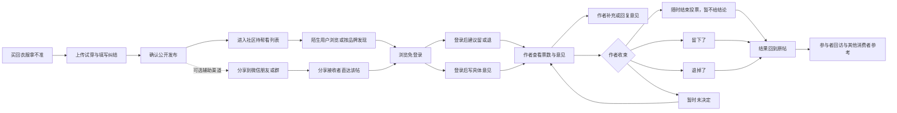

# 留不留：试穿决策最小闭环规格

## MVP 一页结论

- 产品：以陌生人互助为主的试穿、穿搭与购物决策社区，微信分享是辅助渠道。
- 主闭环：微信快捷登录 → 发布试穿和纠结 → 社区发现 → 投票、评论与多层级回复 → 作者随时结束投票或记录留/退 → 继续互动、回访结果。
- 个人闭环：「我的」展示已发布帖子、已投票帖子、评论与回复数量，并能找回自己的求助和参与记录。
- 后端：继续用现有 Vectoree 云后端，经服务端保存账号关联的帖子、投票、评论及统计；本轮不检查或重做 link，由用户后续处理连接配置。
- 首版不做奖励、积分、兑换或排行榜。先验证真实内容与互动价值；统计是个人参与记录，不等于奖励或影响力评分。
- 未获反馈也可结束投票或决定；操作闭环不等于保证有人回复。冷启动需招募愿意帮看的真实用户，不依赖作者拉朋友。
- 以下是实施默认规则，不再逐项请求用户确认；涉及公开范围、费用、破坏性数据操作或确实阻塞的外部条件再单独说明。

## 为什么

用户买回衣服后，难以判断上身效果、搭配和价格是否值得，反复试穿或在综合内容平台求意见，容易拖过退货期限。产品要建立围绕真实试穿和购物决策的陌生人互助社区，让有类似购买经历、品牌兴趣或穿搭经验的人发现问题并参与判断，把意见和最终决定收在同一处。

## 产品定位

- 一句话：试穿拿不准，发到社区，让大家帮你决定留不留。
- 产品形态：以女性用户为主的试穿与购物决策社区，不是以朋友协作为主的决策工具。
- 主要用户：经常买衣服、在意穿搭效果、愿意参考其他消费者意见的女性；不限制其他用户使用。
- 核心场景：一件新买的衣服，搭配已有衣物拍照，希望判断是否留下，以及留下后如何搭。
- 最小价值单位：一条纠结帖被社区里的陌生用户发现，得到真实反馈，作者记录自己的决定；这一过程不依赖作者先分享到熟人渠道。
- 暂用名称「留不留」，描述语「试穿拿不准，找人帮你看」。不在本轮同时改品牌、域名和视觉。
- 用户所说的“客观看一下”解释为获得外部视角，不把网友意见宣传为专业、客观结论。

## 全局地图

社区发现与陌生人反馈是主路径；微信分享是辅助传播和熟人求助渠道，必须支持，但不是发帖后获得意见的前置条件。即使不分享到微信，真实帖子也应进入社区被其他用户看到。不会自动给微信朋友发消息。

## 陌生人为什么参与

以下是需要试用验证的参与动机，不当作已成立的事实：

- 自己也在观望同品牌或类似衣服，想看真实上身、实付价格和最后是否留下；因此品牌与结果是内容价值，不只是发帖资料。
- 对版型、颜色或搭配有经验，愿意用一票或一句具体建议低成本帮别人看。
- 自己也会遇到类似纠结，愿意在社区交换经验；同一个人可以今天求助、明天帮别人。
- 参与后能回来看到作者最终决定与理由，知道自己的意见是否有帮助。

不要求“先帮三个人才能发帖”，不以积分、专家标签或假回复制造参与。首版通过清晰的试穿信息、低成本投票、品牌发现和结果回访验证互助是否自然发生。

奖励可以后续评估，不是首版闭环的必要条件。先观察用户是否主动给有用意见、是否再次参与；只有在内容有价值但参与不足时，才评估认可、徽章或奖励的效果与成本。按投票/评论数量直接发奖容易鼓励刷票和灌水，因此本轮不设奖励规则、积分账户或兑换接口。个人行为统计先让用户看见自己的参与，也为后续评估提供基础，但不能仅凭数量认定意见质量。

## 变更内容

- 以「一件衣服的一次留退决策」统一新帖发布，搭配问题放在期待效果和具体纠结中。
- 品牌从购买渠道中拆出，补充期待效果，简化其他输入。
- 新帖必须包含至少一张照片，不再以通用衣服示意图替代真实判断材料。
- 用实际截止日期替代不变化的“还剩几天”，区分不清楚、不能退和已过期。
- 社区默认展示待帮看的真实帖子，给快到期和没有反馈的求助以基础曝光，而不是让已有热度的帖子占满首屏。
- 增加单帖原生微信分享、无需登录直达详情、登录后返回继续操作。
- 保留投票、意见、作者补充、拍板；去掉低票数门槛式结论，明确意见只是参考。
- 作者可在任何阶段自行结束投票，与记录留/退结论分开；结束投票后仍可继续评论互动。
- 意见支持回复，形成多层级讨论；作者可参与互动，回复不产生或改变留退票。
- 增加品牌查找、我的进行中入口、删除和最小举报处理路径。
- 「我的」新增个人行为统计：已发布帖子、已投票帖子、评论与回复，使用服务端有效记录汇总。
- 复用现有服务端和数据体系，不重建应用，不增加新的社交系统。
- **行为变更**：新帖不再支持纯示意图发布或独立“只问搭配”模式；历史帖子不删除。

## 影响范围

- 能力：发布、帖子详情、微信分享、账号恢复、期限计算、社区发现、投票结束与评论互动、决策、内容治理。
- 小程序：`miniprogram/pages/{feed,compose,detail,me,login}`、`miniprogram/utils/{store,format,seed}.js`，必要时增加小型配置或公共工具。
- 共享服务：`src/lib/{types,community-data,format,storage}.ts`、`src/app/api/community/*`，必要时新增单帖读取和举报接口。
- 数据：帖子新增品牌、期待效果、退货状态、真实截止日期和投票结束状态；意见增加回复关系，支持多层级展示；新增最小举报记录；图片和现有账号、投票、意见继续复用。
- 网页：只做共享字段与旧客户端的必要兼容，不要求同步重做网页视觉或分享功能。
- 测试：扩展 `scripts/verify-community.mjs` 或独立的行为测试。
- 2026-11-17 用户同意全局复核后拆分实施，当前进入代码实施与本地验证阶段；远端数据结构、微信真机与产品试用尚未验收。

## 范围与优先级

### 首版必需

发布带图纠结帖、陌生人社区发现与待帮看分发、免登录浏览、登录后投票和评论、意见回复互动、作者补充、作者随时结束投票与拍板、真实期限展示、品牌查找、个人记录与反馈回访、微信朋友/群分享、公开告知、删除、举报和失败恢复。

### 首版明确不做

- AI 穿搭评估、试衣、评分或自动留退建议。
- 私信、关注、好友关系、收藏、点赞、积分、排行榜；评论只做意见回复与互动，不做置顶、表情、富文本或折叠排序。
- 品牌资料库、品牌关注、同款商品匹配、购物链接和带货。
- 多件衣服对比、A/B 搭配投票、数字衣橱、复杂身材档案。
- 私密帖、仅朋友可见、口令访问；微信分享不代表帖子私密。
- 朋友圈海报、奖励裂变、自动群发、搜索推荐算法。
- 订阅消息、短信、后台定时提醒。首版只有应用内期限提示，不能保证用户不再错过退货。
- 为运营重建后台界面；首版可使用受权限保护的现有管理工具人工处理举报。

订阅消息在真实账号、类目和模板可用性确认后评估；不能以它为首版已具备的能力。

## 页面与交互

| 页面 | 核心目的 | 首屏或主要动作 |
| --- | --- | --- |
| 社区 | 陌生人发现求助，也参考别人的购买经验 | 照片、问题、品牌/价格、期限；默认待帮看，最新/快到期，品牌查找 |
| 发布 | 低负担表达一次纠结 | 照片、具体纠结、期待效果、品牌/价格、退货状态 |
| 详情 | 一眼看懂并给意见 | 照片与问题在前，留退按钮、意见与回复、分享；作者可回复、补充、随时结束投票与拍板 |
| 我的 | 查看个人参与和社区反馈，回访决策 | 已发布、已投票、评论与回复统计；进行中、已结束投票、已拍板、我参与的 |
| 登录 | 只在需要写入时确认身份 | 微信登录优先，回到原帖或原草稿 |

不增加通知页和品牌页。沿用现有社区、发布、我的三个导航入口和「宣纸·赤陶」基础视觉。用户不应为投一票先填写昵称、身材、风格问卷。

### 发布字段

| 字段 | 规则 | 对判断的价值 |
| --- | --- | --- |
| 照片 | 必填 1–9 张，建议第一张上身全貌；可调整封面、删除、大图预览 | 看版型、颜色与真实搭配 |
| 具体纠结 | 必填 4–400 字，单一文本输入；首段生成列表摘要，不再重复填写标题 | 明确用户到底问什么 |
| 想穿出的效果 | 选填最多 120 字，提示如“通勤显利落”“想配已有牛仔裤” | 将意见对齐用户目标 |
| 品牌 | 选填最多 30 字，独立字段；纯空白视为未填 | 同品牌用户共鸣和发现 |
| 实付价格 | 选填，人民币 0–999999.99，最多两位小数 | 提供价值判断背景 |
| 退货状态 | 必须明确选择“可退，知道截止日期”“截止日期不清楚”“不能退” | 不默认猜测还有三天 |
| 截止日期 | 可退且知道日期时必填，日期为中国时区 YYYY-MM-DD | 明确实际时间边界 |

品牌和价格重要但不强制，避免用户为了发布先找订单。购买渠道、品类和衣服名称不再作为新帖表单输入；旧字段可继续兼容存储。不强制露出人脸、身材信息或订单截图。

## 新增需求

### R1：集中表达并可靠发布

系统必须让用户围绕一件主体衣服发布多图纠结帖。服务端与客户端执行一致的长度、价格、图片数量和期限校验；图片沿用每张压缩后最大 700 KB 的限制。发布只能在全部图片及帖子写入成功后显示成功，重试相同提交标识不能产生重复帖子。

#### 场景：正常发布
- **当** 用户上传试穿、填写纠结并确认退货状态，登录后确认公开发布
- **那么** 帖子完整保存并进入社区待帮看列表，跳到本帖，说明可在「我的」查看反馈；分享是可选次要动作，不要求发给朋友才能等待意见。

#### 场景：用户中断或请求失败
- **当** 用户返回、去登录、上传失败、断网或发布响应丢失
- **那么** 已输入文字和图片顺序不会被主动清空；重进发布页可恢复本地草稿；重复提交不重复发帖。
- 临时照片路径失效时提示重新选择相应照片，不能声称已恢复有效图片。
- 删除未发布草稿应允许用户显式确认，提交成功后清除该草稿。

### R2：品牌共鸣与目标上下文

系统必须在详情展示已填写的品牌、实付价格和期待效果，未填项不占位；社区列表显示品牌与价格。品牌查找只匹配品牌字段，去首尾空格、不区分拉丁字母大小写，支持包含匹配，清空后恢复列表。点击帖子中的品牌可进入同一社区的品牌筛选状态，不增加品牌详情页。

#### 场景：找到同品牌纠结
- **当** 用户输入或点击「优衣库」
- **那么** 社区显示品牌中包含该关键词的可见帖子，无结果时说明并提供清空条件入口。

### R3：微信分享与直达

系统必须支持从真实帖子详情使用微信原生分享发给朋友或群，分享路径携带稳定帖子 ID，封面使用首图，标题说明正在求意见，不含手机号、账户 ID 或令牌。无图历史帖可使用文字分享，不强制新增海报系统。

#### 场景：朋友首次打开
- **当** 未登录朋友打开分享卡片
- **那么** 直接进入被分享的帖子并浏览照片、背景、票数和意见，不先到首页，也不先登录。

#### 场景：分享成功提示
- **当** 用户点击分享入口或打开分享面板
- **那么** 不能把这一行为记成朋友已收到或已帮忙，不展示虚假的「分享成功」结论。

#### 场景：帖子不存在或读取失败
- **当** 帖子被删除、下架或 ID 无效
- **那么** 显示不可用状态，不泄露原图和原文，提供回社区入口。
- **当** 请求失败而帖子是否存在尚不明确
- **那么** 显示网络失败与重试，不能当作删除，也不能以示例帖子替代。

### R4：公开边界与撤回

首版帖子均公开进入社区，分享链接不是访问权限。发布按钮附近必须明确告知「帖子会公开展示，分享到微信也不是私密帖；可不露脸，避免上传订单地址等信息」。用户必须主动确认公开发布，之后仍可删除自己的帖子。

#### 场景：作者删除
- **当** 作者确认删除自己的帖子
- **那么** 社区、我的记录和分享详情不再展示内容，关闭互动，并安排关联图片清理。
- 删除应由服务端校验作者身份；图片清理失败可重试，不能因此让已删除内容重新可见。
- 图片访问必须随可见状态关闭；公开前已被他人保存、截图或已下载到设备的内容无法追回，隐私说明不得承诺删除能消除这些副本。

### R5：基础内容治理

系统必须提供帖子和意见举报入口，可选择隐私泄露、辱骂或骚扰、广告或其他原因；举报者登录后提交，重复同一内容的待处理举报不重复创建。受限运营权限可查看并人工下架或移除内容；普通用户不能访问举报记录或执行治理。

#### 场景：有人身攻击
- **当** 用户举报针对身材的辱骂意见
- **那么** 系统确认收到举报但不承诺已删除，运营处理后该意见不再显示或计入意见数。

平台审核、隐私政策、用户协议及适用的账号注销要求属于上线门槛，正式发布前应核实微信平台要求。未核实前不能宣称小程序已可上线。

## 修改需求

### R6：真实退货时间，不替用户猜测

系统必须保存退货状态和实际截止日期，用服务端时间计算中国时区的日期提示。首版日期统一解释为截止当日 23:59:59（北京时间），同时明确「以商家订单显示为准，提前操作退货」；不声称已接入商家期限。

应用启动、页面再次显示和跨日刷新时重新计算。截止当天显示「今天截止」，之前显示剩余日历天数，之后显示「已过退货期」；不清楚与不能退不能混用。

#### 场景：跨日
- **当** 同一帖子前一天还有 1 天，到了截止日期当天
- **那么** 社区、详情、我的都显示「今天截止」，无需作者改帖。

#### 场景：还没有决定却已过期
- **当** 截止日期过去且作者未拍板
- **那么** 保留未拍板状态，显示过期提示，不自动记录「留下了」。

#### 场景：填写或修正期限
- **当** 用户选择已过去的截止日期或作者需要修正日期
- **那么** 明确显示过期状态并允许确认；仅作者可修改退货状态/日期，不修改票数和创建时间。

快到期筛选只含未拍板、投票未结束且距有效截止日期 0–3 天的帖子，按截止日期升序、同日按创建时间降序；未知、不能退、已过期、已拍板与已结束投票不混入。

### R7：意见和投票是参考

新帖统一有「建议留」「建议退」两个投票选项，同时允许只写搭配意见。每个账号每帖最多一票，可改投，不累计重复票；作者不能给自己投票。权限和状态必须由服务端校验。

票数实时显示已获取的真实计数，零票明确为空，任何票数都可以拍板。少于 5 票显示「样本很少，仅供参考」，不采用现有“8 票才够”的结论门槛，也不把票数直接变成最终决定。

#### 场景：用户只给搭配建议
- **当** 社区用户登录后写意见但没有选择留退
- **那么** 只增加一条意见，不自动给帖子投票。

#### 场景：改投和重复请求
- **当** 用户先建议留，再建议退，或重复发送同一投票
- **那么** 留票减一、退票加一，重复请求不重复增加计数。

意见 4–180 字，免填写独立署名，使用账号展示名。任意登录用户可回复某条意见，形成多层级讨论；作者的补充与回复同样标为「作者补充」。回复只形成讨论，不产生或改变留退票，也不受投票是否结束限制。用户可撤回自己的意见；若该意见已有回复，撤回前提示将一并隐藏该串讨论，撤回后相关回复不再展示且意见计数同步更新。

### R8：作者随时收束与互动

系统必须把「结束投票」和「记录留/退结论」做成两个独立动作，均由作者在帖子的任何阶段自行触发，不受期限、票数或反馈数量限制，也不因过期而失效。

- 结束投票：立即停止投票与改投，保留并展示已获得的票数，标记「投票已结束」；不产生留/退结论，帖子退出待帮看与快到期分发。
- 记录结论：选择「留下了」或「退掉了」，可选写最多 180 字的决定理由；记录时若投票尚未结束则一并关闭，已获得的票数保留展示。
- 结束投票或记录结论后，作者仍可补充、回复评论、修改结论；这些动作都不重开投票，也不篡改他人的历史票数。
- 操作前提示这只是记录作者自己的决定，不会代为退款；成功后原帖和我的记录都展示结果。

#### 场景：先停投票，还没给结论
- **当** 作者认为意见已经够用，只想先停止收集意见
- **那么** 投票关闭并标注「投票已结束」，不显示「留下了/退掉了」；作者可以稍后再给结论，帖子不再出现在待帮看和快到期。

#### 场景：意见不多也能拍板
- **当** 作者只有一条社区意见或完全没有反馈，仍决定退掉
- **那么** 可直接记录「退掉了」，不要求票数、等待时间或多数赞同。

#### 场景：结束后继续互动
- **当** 作者在结束投票或已拍板后补充想法，并回复某条意见
- **那么** 新内容按评论展示并标记「作者补充」，投票保持关闭，其他用户仍可继续回复，除非帖子被删除。

#### 场景：修改结论
- **当** 作者修改已记录结论
- **那么** 仅更新作者结论和理由，不重开投票，不篡改他人的历史票数。

「退掉了」是作者自行报告，不表示系统核实商家退款。作者不结束投票也可以继续使用，不强制完成仪式；但投票未结束的帖子会持续出现在待帮看中等待反馈。

### R9：浏览无门槛，写入有身份

浏览公开帖、图片、票数和意见不要求登录。发帖、投票、评论、回复、结束投票、拍板、删除与举报要求身份，优先使用微信快捷登录；服务端密钥不下发到小程序。沿用现有 `wx.login` → 服务端校验微信身份 → Vectoree 应用账号与会话方案，正式联调时核实平台契约，不假设 Vectoree 原生提供微信 OAuth。登录不强制授权手机号、头像或填邮箱，账号展示名可使用默认昵称。

#### 场景：社区或分享进来投一票
- **当** 从社区或分享进入的未登录用户点击建议留，完成登录
- **那么** 回到原帖，保留其操作意图；重新验证帖子可互动后完成一次投票并显示确认状态。
- 登录取消或失败不丢失帖子和已写意见，不自动跳回首页；帖已删除、已拍板或投票已结束时提示不可继续投票，仍可浏览与评论。

微信账号配置与 HTTPS 合法域名是真机验证前提，游客模式和本地成功不等于正式微信登录、分享与上线成功。邮箱路径保留为开发兼容，不作为正式小程序主流程。

### R10：社区发现、第一条反馈与回访

系统必须在社区首页提供默认「待帮看」、以及「最新」「快到期」视图，复用同一列表而非新增页面：

- 待帮看只含可见、未拍板且投票未结束的真实留退帖；快到期的 0–3 天帖子先展示，按截止日期升序；其余帖子中尚无他人反馈的先展示，同组按发布时间升序。相同排序键以稳定 ID 排序。
- 快到期组内同一截止日期优先尚无他人反馈者，再按发布时间升序，避免新帖持续挤掉先发布的求助。
- 他人反馈指真实非作者的投票或仍可见意见；作者的补充与回复都不算他人反馈。有反馈的帖子仍可出现在待帮看，不以“一票”判定已解决。
- 最新包含可见的真实求助，以及已拍板或已结束投票的帖子，按发布时间降序；已收束的帖子标注结果，可作为其他消费者的参考。
- 快到期视图沿用 R6 的日期范围和排序。品牌条件与当前视图组合，不增加复杂个性化算法。

社区卡片让陌生用户先看到试穿、具体问题、品牌/价格、期限与反馈数量；不以作者粉丝数、已有票数或争议程度决定曝光。未登录用户可从首页直接浏览，第一次投票或写意见才登录。

我的页面让作者分开查看进行中与已结束投票的帖子，含真实票数、意见数与期限，让参与者在「我参与的」查看作者最终结果。进行中按有效日期优先、其他按最近发布排序。首版采用页面进入和手动刷新更新，不建消息中心、不声称已主动推送新反馈。

#### 场景：没有分享到朋友也获得社区曝光
- **当** 用户发布真实求助，没有进行任何微信分享
- **那么** 其他用户能从社区待帮看、最新或品牌查找中发现该帖并参与；不要求双方有好友关系。

#### 场景：还没有人帮看
- **当** 帖子尚无真实他人反馈
- **那么** 在待帮看内按上述规则获得基础优先级，显示「还没有人给意见」，不伪造回复、不要求作者自行拉朋友。

#### 场景：社区冷启动
- **当** 社区没有真实帖子
- **那么** 显示清晰发布入口与社区用途，不制造假投票或回复。
- 原有示例可保留在明确标记的演示区域，不进入真实社区排序、品牌结果或验证指标，不作为真实求助互动对象。
- 作者可以分享，但不能把分享给朋友当作社区缺少反馈的唯一解决方案。没有真实反馈供给时需运营招募和产品验证，而非增加“邀请好友”门槛。

### R11：「我的」个人行为统计

系统必须在「我的」账号信息下展示三个统计：**已发布**（帖子数）、**已投票**（帖子数）、**评论与回复**（条数）。它们是当前有效参与记录，不是终身累计动作次数、奖励积分或公开排行榜。

| 指标 | 默认统计口径 |
| --- | --- |
| 已发布 | 当前账号成功发布且未删除/下架的真实帖子；进行中、已结束投票和已拍板均计入，草稿与演示不计入 |
| 已投票 | 当前账号在未删除/下架真实帖子上拥有的有效留退票，每帖最多计 1；改投和重试不增加，投票结束后历史票仍计入 |
| 评论与回复 | 当前账号已成功发送且仍可见的顶层评论和各层回复，每条计 1；作者补充/作者回复也计入，决定理由不计入；撤回、移除或因父评论撤回而隐藏的记录不计入 |

统计由服务端基于当前会话账号在 Vectoree 的完整有效记录汇总，不从分页社区列表、客户端点击次数或本地缓存推算，不接受客户端指定其他用户身份。首版不新增事件账本和终身累计系统。

#### 场景：写入与回访
- **当** 用户成功发布一帖、给其他帖子投一票、写一条评论并回复一次
- **那么** 「我的」刷新后相应统计增加 1、1、2，换设备登录同一账号可看到一致数据。
- 写入失败、重复请求或改投不产生额外计数；结束投票不清空已投票数量。

#### 场景：撤回与删除
- **当** 用户撤回自己的评论或删除自己的帖子
- **那么** 「我的」刷新后按有效记录重新汇总，相关不可见评论及该帖上的票不再计入对应用户统计；不删除无关记录。

#### 场景：登录与失败
- **当** 用户未登录
- **那么** 显示登录入口与「登录后查看参与记录」，不把其他账号缓存或演示数据当作个人统计。
- **当** 服务端统计加载失败
- **那么** 显示暂不可用与重试，不以 0 冒充真实数据；退出登录立即移除该账号统计，避免下一账号看到旧数据。

点击已发布与已投票可定位相应个人帖子列表。评论与回复首版只展示汇总数字，「我参与的」继续提供参与帖回访，不增加独立评论历史页或通知中心。

## 移除需求

### 新帖示意图发布
**原因**：无法回答用户这件衣服实际上身是否合适。
**迁移**：历史示意图继续标为示例；新帖必须有照片，失败时不回退示意图。

### 新帖独立“只问搭配”类型和复杂排序
**原因**：首版围绕留退决策，不同时建设穿搭问答产品；“最难选”会强化纠结而非收束。
**迁移**：新帖统一沿用兼容的留退类型，期待效果承接搭配问题；旧 `both` 帖仍可留退，历史 `style` 帖可浏览和评论、不出现留退投票或拍板、不进入进行中或待帮看。保留待帮看、最新与快到期，取消首屏“最难拍板”推荐。

## 数据与状态约束

- 建议新增字段：`brand`、`desired_effect`、`return_status`（known/unknown/unavailable）、`return_deadline`、`decision_reason`、投票结束状态（如 `votes_closed_at`）、删除/下架状态；意见增加回复目标（如 `parent_id`）以支持多层级讨论。具体命名以实施时核实数据库为准，语义不得变。
- 新帖详情不依赖先加载完整社区列表，单帖按 ID 读取且遵守可见状态，权限与作者身份由服务端计算。
- 投票唯一约束为账号与帖子组合；发布标识用于同次重试幂等，失败上传资源需回收。
- 发布先保存不公开的 `publishing` 记录再写图片，全部成功后切换为 `published`；并发重试复用同一帖子 ID。半成品不进入社区与统计，响应不确定时先核实记录，不清理已公开帖子的资源。
- 投票写入和关闭投票、回复与父评论撤回需数据库行锁/约束保障跨进程一致性。本地准备 SQL 未应用前，不宣称远端并发安全已验证。
- 图片代理每次核实关联帖子可见，返回 `no-store`；仍需远端确认存储桶私有及历史直链不可访问。删除不能追回他人已下载的照片。
- 期限、投票状态与结论三者独立：可退/未知/不能退/过期，投票进行中/已结束，未给结论/已留/已退，不互相推导；结束投票不等于留下，过期也不等于留下。
- 历史 `days_left` 没有可靠日期来源时显示「截止日期待确认」，不得凭当前日期续期；作者可补充真实日期。
- 旧品牌与购买渠道不能机械互转；缺失品牌/目标按未填写处理，保持历史正文、图片与互动不丢失。
- 为旧网页请求保留必要兼容，不能因为新字段让旧帖读取崩溃。真实期限语义不能回退到永久不变的倒计时。
- 默认先人工刷新和页面显示时更新反馈，不做实时连接。列表与单帖加载失败明确提示，不能把离线演示伪装为云端成功。
- 个人统计由 Vectoree 有效记录按账号服务端汇总；不因客户端列表分页、设备更换或重试产生漏算/重复计算。本轮不配置云端、不检查 link；连接未恢复时保留联调未完成状态，不用模拟数据宣称云端已通。

## 验证与上线门槛

### 工程验收

按 checklist.md 验证表单、时间边界、分享登录回跳、幂等、作者权限、删除和治理，并完成真实微信账号的两台设备测试。浏览器预览只能辅助确认展示，不能代替微信分享和真机登录验收。

### 产品验证

先招募一个有共同品牌或购物兴趣的小规模种子社区，不把“大社区”理解为首版必须有大量功能。建议首轮招募 5–10 位有真实纠结的发帖者，以及 10–20 位愿意浏览和给意见的消费者，允许角色互换；不要求给意见者与发帖者互为朋友。人数只是试用建议，不是技术门槛或达成增长的保证。

核心试用必须包含作者未分享到熟人、由社区发现并获得陌生人反馈的帖子；两台设备验证朋友分享仍保留为辅助链路验收，不能代替社区价值验证。

观察：社区进入详情与参与情况、发帖后首次陌生人反馈耗时、未获得反馈的帖子占比、具体意见是否有帮助、作者是否在期限前拍板、帮看者是否愿意再次参与。记录试用观察窗口及样本规模，未获反馈的帖子不能从时效统计中直接删除。

建议记录或人工回访：发布、社区详情进入、投票/意见、作者拍板、参与者回访；分享入口点击不等于分享送达。陌生人与熟人关系通过试用访谈确认，不以“不同账号”或“没点分享”自动推断；运营协助和自发参与分开记录。排除作者、演示数据和测试账号，未填写期限的帖子不进入“期限前拍板率”分母。

核心验证是陌生人是否愿意帮看、求助是否能得到有用反馈、作者是否更快收束，不以注册数或熟人投票代替。冷启动需要真实内容和参与者招募，列表排序本身不创造意见供给；首轮不设未经验证的增长目标、不承诺回复时效。

## 实施约定

- 暂保留「留不留」名称，重点在流程而不是新品牌设计。
- 首版公开社区，品牌/价格/目标选填，截止状态必选。
- 用户已明确：陌生人社区是核心，微信分享只是辅助渠道；首版就验证社区发现与陌生人参与，不等待熟人模式跑通后再转型。
- 用户已明确：首版具备发帖、社区互动、作者自主结束投票与决策、微信快捷登录、Vectoree 云后端及「我的」行为统计；奖励留待后续。
- 常规交互和统计口径按本文默认处理，不再逐项要求用户确认；完成状态以测试与验收记录为准。
- 用户已授权全局复核后拆分任务执行；Vectoree 连接配置由用户后续处理，不擅自重建、迁移或操作远端数据。
